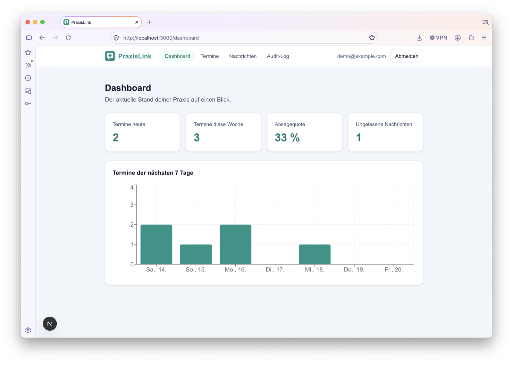
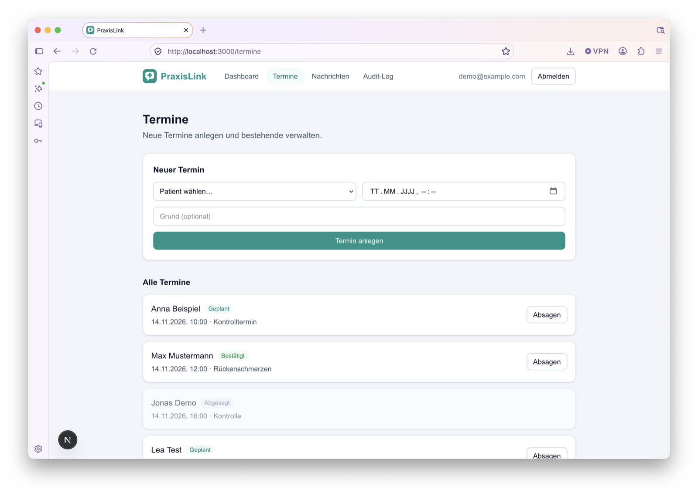
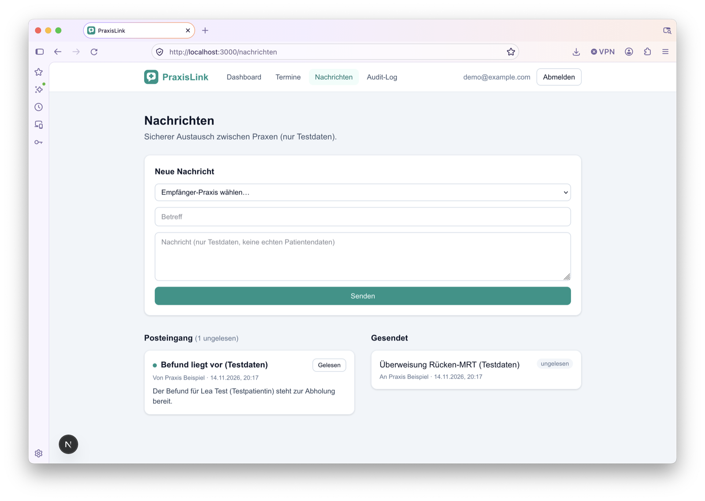
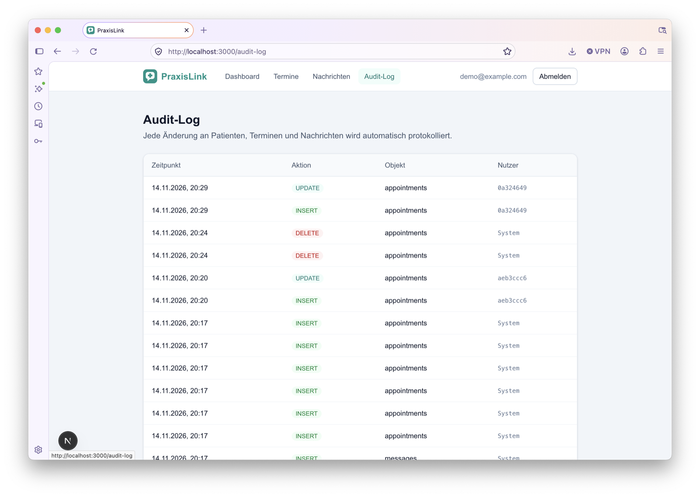

# PraxisLink

Webanwendung für die Terminverwaltung und den Nachrichtenaustausch zwischen Arztpraxen.
Entstanden als Portfolio-Projekt im Studium Medizinische Informatik (FH Dortmund).

**Live-Demo:** DEIN-LIVE-LINK

> **Hinweis zum Datenschutz:** Das Projekt verwendet ausschließlich erfundene Beispieldaten.
> Es werden keine echten Patientendaten gespeichert oder verarbeitet.



## Funktionen

- **Login und Rollen:** Registrierung und Anmeldung, Rollen Praxis und Admin
- **Terminverwaltung:** Termine anlegen, ansehen und absagen
- **Dashboard:** Kennzahlen (Termine heute und diese Woche, Absagequote, ungelesene Nachrichten) und ein Diagramm der nächsten sieben Tage
- **Nachrichten:** Austausch zwischen Praxen mit Posteingang, Gesendet und Lesestatus, angelehnt an das Prinzip von KIM (stark vereinfacht)
- **Audit-Log:** Änderungen an Patienten, Terminen und Nachrichten werden per Datenbank-Trigger mit Nutzer und Zeitpunkt protokolliert, einsehbar für Admins

## Datenschutz und Sicherheit im Entwurf

- **Mandantentrennung per Row Level Security:** Jede Praxis sieht nur die eigenen Patienten und Termine. Das wird in der Datenbank erzwungen und nicht nur in der Oberfläche.
- **Nachrichten** sind nur für die Absender- und die Empfänger-Praxis sichtbar.
- **Audit-Log** nur für Admins lesbar.
- **Zugangsdaten** liegen in Umgebungsvariablen und nicht im Repository.

Das Datenbankschema mit allen Regeln steht in [`schema.sql`](./schema.sql).

## Screenshots

| Termine | Nachrichten |
|---|---|
|  |  |



## Technik

| Bereich | Technologie |
|---|---|
| Frontend | Next.js, React, TypeScript, Tailwind CSS, Recharts |
| Backend und Datenbank | Supabase (PostgreSQL, Auth) |
| Zugriffsschutz | Row Level Security |
| Deployment | Vercel |

## Lokal starten

```bash
git clone https://github.com/manalrhranati/praxis-connect.git
cd praxis-connect
npm install
```

Lege eine Datei `.env.local` mit deinen Supabase-Werten an:
NEXT_PUBLIC_SUPABASE_URL=https://bdxhilhkohkmpslgnhpf.supabase.co
NEXT_PUBLIC_SUPABASE_PUBLISHABLE_KEY=sb_publishable_Ko0TPFyheXbqP81D6wzx0Q_eibbebE8

Führe den Inhalt von `schema.sql` im SQL Editor deines Supabase-Projekts aus, dann:

```bash
npm run dev
```

## Mögliche Erweiterungen

- Ende-zu-Ende-Verschlüsselung der Nachrichten
- FHIR-Schnittstelle für Termine
- Formular zum Anlegen von Patienten
- E-Mail-Benachrichtigungen